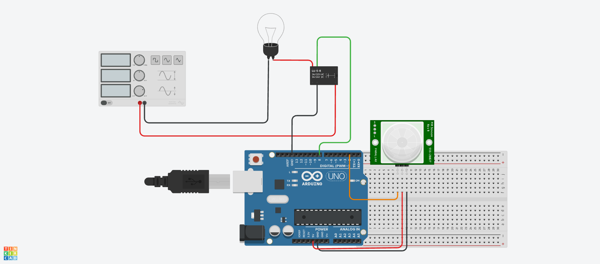

# Projeto final arquitetura e organização de computadores

> Descrição curta: Projeto de automação para ligação de lampada através de um sensor de movivmento, com arduino UNO.

## Sobre

Esse software tem como objetivo dectar movimentos através de um sensor PIR e chavear o rele para ligação automatica de uma lampada

## Funcionalidades

- [x] Detecção de movimento
- [x] Chaveamento de rele

### Hardware

- Arduino UNO
- Sensor de movimento PIR
- Rele
- Cabo USB
- Jumpers
- Lampada 9v LED
- Cabos de energia

### Software

- C
- Arduino IDE

